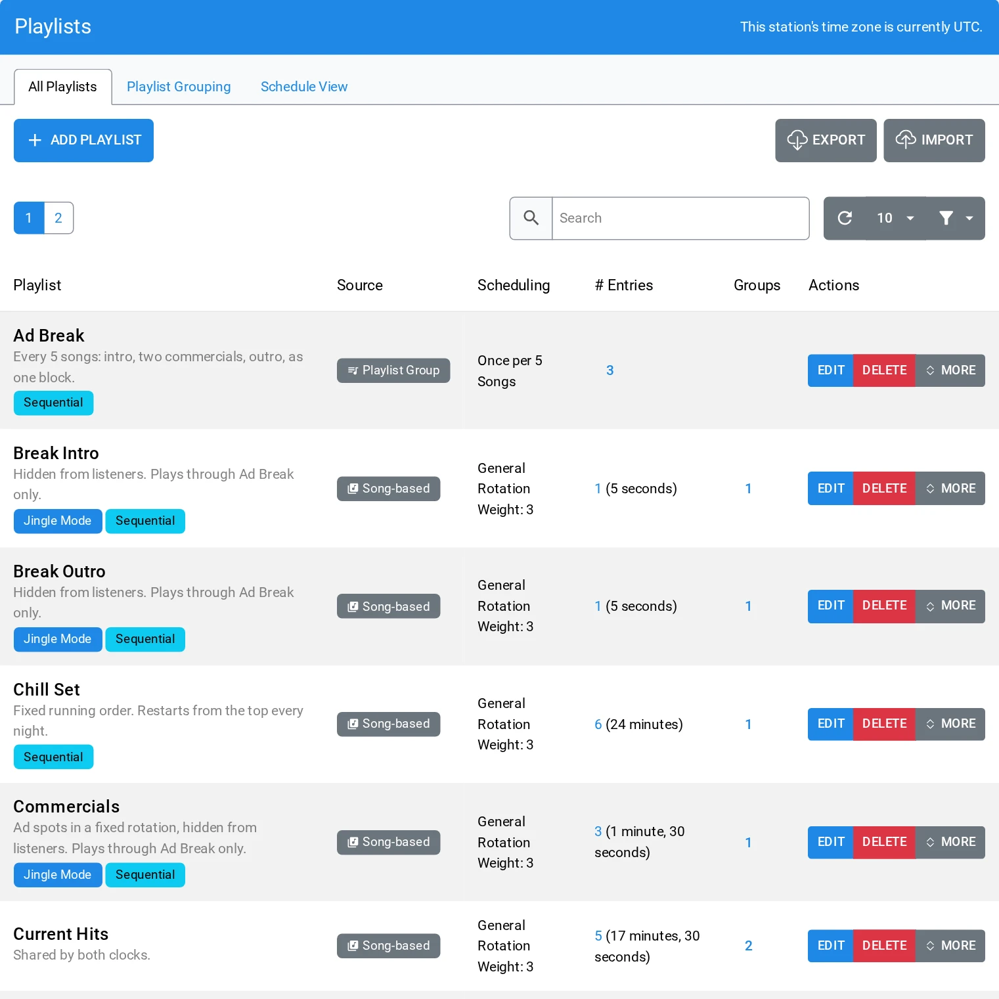

import { Card, CardGrid, LinkCard, Steps } from '@astrojs/starlight/components';

Playlists are the rules your AutoDJ follows. They decide which songs play, how often, at what times and in which order. The AutoDJ only plays media that is in at least one enabled playlist.

:::tip[Required Permissions]
To manage playlists, users must be in a role that has the "Manage Station Media" permission for the given station.
:::

## How a playlist is defined

Every playlist is built from a combination of four settings:

<CardGrid>
	<Card title="Source" icon="document">
		**What** the playlist plays:
		- songs from your library
		- other playlists (a [playlist group](/docs/user-guide/playlists/groups/))
		- a remote stream
		- or listener requests
	</Card>
	<Card title="Type" icon="setting">
		**How often** it plays:
		- in the general rotation
		- once every few songs or minutes
		- or once per hour
	</Card>
	<Card title="Schedule" icon="clock">
		**When** it's allowed to play:
		- always
		- or only at the days and times you choose
	</Card>
	<Card title="Playback order" icon="random">
		**Which song comes next**:
		- shuffled
		- random
		- or in a fixed order
	</Card>
</CardGrid>

All settings are explained in detail on the [Playlist Settings](/docs/user-guide/playlists/settings/) page.

## The Playlists page

The **Playlists** page in the station menu is split into three tabs:

- **All Playlists** lists every playlist with its source, schedule, number of entries and the groups it belongs to. The list can be filtered by source, type or playback order. From here you can add playlists, edit them, and [export and import](/docs/user-guide/playlists/managing/#backing-up-and-moving-playlist-setups) your playlist setup.
- **Schedule View** shows all scheduled playlists in a weekly calendar, see [Scheduling](/docs/user-guide/playlists/scheduling/#the-schedule-view).
- **Playlist Grouping** is where you build [playlist groups](/docs/user-guide/playlists/groups/#the-playlist-grouping-tab).

## Quick start: your first playlist

New stations come with an empty playlist called **default**. You can use it, or create your own:

<Steps>

1. Upload your music under **Media › Music Files**, see [Media Management](/docs/user-guide/media-management/).

2. Open **Playlists** and click **Add Playlist**. Enter a name, leave **Source** on **Song-Based** and **Playlist Type** on **General Rotation**, and save.

3. Go back to **Media › Music Files**, select the songs you want, click **Playlists**, check your new playlist and save. You can also [link a whole folder](/docs/user-guide/playlists/managing/#linking-folders-to-a-playlist) to the playlist.

4. Check the result: on the **Playlists** page, open the playlist's **More** menu and click **Playback Queue** to see the order its songs will play in. Under **Broadcasting › Upcoming Song Queue** you see the songs the AutoDJ has already lined up.

</Steps>

## Which setup do I need?

| I want to… | Use |
| --- | --- |
| Play my music library all day | A **General Rotation** playlist, see [playlist types](/docs/user-guide/playlists/settings/#playlist-type). |
| Play a jingle every few songs | A **Once per x Songs** playlist, or a [group with a jingle slot](/docs/user-guide/playlists/group-examples/#two-songs-then-a-jingle). |
| Play a station ID at the top of every hour | A **Once per Hour** playlist, or a [top-of-the-hour group](/docs/user-guide/playlists/group-examples/#top-of-the-hour). |
| Run a show on certain days and times | A [scheduled playlist](/docs/user-guide/playlists/scheduling/). |
| Start a show exactly on time | A playlist with the [interrupt option](/docs/user-guide/playlists/scheduling/#exact-start-times). |
| Play an ad break with several spots back to back | A [group that plays as one block](/docs/user-guide/playlists/group-examples/#ad-break-every-5-songs). |
| Build a fixed format clock | A [playlist group](/docs/user-guide/playlists/group-examples/#basic-clockwheel). |
| Play listener requests only at certain times | A [request queue playlist](/docs/user-guide/song-requests/#request-queue-playlists). |
| Relay another station's stream at certain times | A [remote URL playlist](/docs/user-guide/playlists/settings/#source) with a schedule. |
| Control a playlist with my own Liquidsoap code | An [advanced playlist](/docs/user-guide/playlists/advanced/). |

## Definition of key terms

- **Playlist group:**
	- a playlist that plays other playlists instead of songs.
- **Member:**
	- a playlist inside a playlist group.
- **Slot:**
	- one position in a group's running order. A group plays one slot per turn.
- **Cycle:**
	- one complete pass through a playlist's songs or a group's members. After a cycle, the playlist starts over.
- **Playlist queue:**
	- the songs a playlist still has to play in its current cycle. Shown under **Playback Queue**.
- **Upcoming Song Queue:**
	- the songs the AutoDJ has already picked for the station. It's filled a few songs ahead.
- **Scheduled time:**
	- a time window from a playlist's schedule, for example Mondays from 18:00 to 20:00.
- **Jingle:**
	- a short clip, such as a station ID, played without showing its title to listeners.

## Advanced Playlists

Advanced playlists are for power users who want to control a playlist with their own Liquidsoap code, while AzuraCast still manages its songs. Most users won't need them.

<LinkCard title="Advanced Playlists & Liquidsoap" href="/docs/user-guide/playlists/advanced/" />

## Where to go from here

<LinkCard title="Playlist Settings" description="Every option in the playlist editor." href="/docs/user-guide/playlists/settings/" />
<LinkCard title="Adding Media & Playlist Actions" description="Fill playlists, reorder, reshuffle, import and export them." href="/docs/user-guide/playlists/managing/" />
<LinkCard title="Scheduling" description="Days, times, overnight shows and exact start times." href="/docs/user-guide/playlists/scheduling/" />
<LinkCard title="Playlist Groups" description="Build clocks, blocks and nested rotations." href="/docs/user-guide/playlists/groups/" />
<LinkCard title="Playlist Group Examples" description="Ready-made setups to import and adapt." href="/docs/user-guide/playlists/group-examples/" />
<LinkCard title="Song Requests" description="Let listeners request songs and decide when they play." href="/docs/user-guide/song-requests/" />
<LinkCard title="How the AutoDJ Picks Songs" description="The rules behind every pick, and how to see why a song played." href="/docs/user-guide/playlists/autodj-logic/" />
<LinkCard title="Troubleshooting & FAQ" description="When a playlist doesn't play the way you expect." href="/docs/user-guide/playlists/troubleshooting/" />
