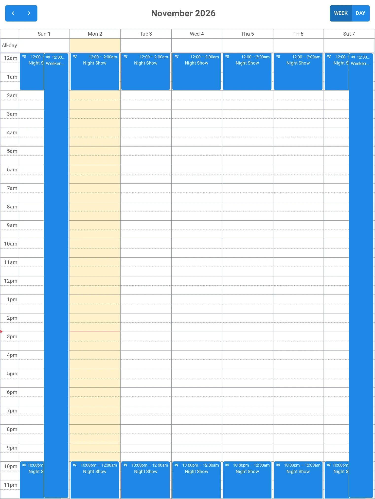

import { Steps } from '@astrojs/starlight/components';

A schedule limits when a playlist is allowed to play. Every kind of playlist can have a schedule, including [playlist groups](/docs/user-guide/playlists/groups/) and [Request Queue playlists](/docs/user-guide/song-requests/#request-queue-playlists).

## Unscheduled vs. scheduled playlists

- A playlist **without a schedule** may play at any time
- A playlist **with a schedule** may only play during its scheduled times

While a scheduled playlist is within its scheduled time, it is prioritized over unscheduled playlists of the same type. A scheduled **General Rotation** playlist therefore takes over from all unscheduled General Rotation playlists. To run a show, give the show's playlist a schedule. Your unscheduled playlists then keep playing whenever the show is not on air.

## Adding a schedule

<Steps>

1. Edit the playlist and open the **Schedule** tab.

2. Click **Add Schedule Item**.

3. Set a **Start Time** and an **End Time**.

4. Optionally select the days under **Scheduled Play Days of Week**. If you select none, the schedule applies to every day.

5. Optionally set a **Start Date** and an **End Date** to use the schedule only within that date range.

6. Save the playlist.

</Steps>

A playlist can have several scheduled times, for example one for weekday mornings and one for Saturday nights. Click **Add Schedule Item** again for each of them. **Remove** deletes a scheduled time.

## How times are evaluated

All times use the **station's time zone**, which is shown under the times in the editor and set in the station settings. A show at 06:00 starts at 06:00 local time all year, even when the clocks change for daylight saving time.

### Common examples

| Example | Start Time | End Time | Days | Other settings |
| --- | --- | --- | --- | --- |
| Weekday mornings | 06:00 | 09:00 | Monday to Friday | – |
| Saturday night show | 22:00 | 02:00 | Saturday | – |
| One song every day at noon | 12:00 | 12:00 | Every day (none selected) | **Only play one track at scheduled time** on the **Advanced** tab |
| Holiday special | 00:00 | 23:59 | Every day (none selected) | **Start Date** and **End Date** of the holiday |

### Special cases

- **Overnight:** if the end time is before the start time, the scheduled time runs past midnight into the next day
  - Select the days and dates for the day the show starts, not the day it ends
    - For a show from Saturday 22:00 to Sunday 02:00, select only Saturday under **Scheduled Play Days of Week**
    - For a one-time show from December 31 22:00 to January 1 02:00, set both **Start Date** and **End Date** to December 31

- **Start time equals end time:** the scheduled time will last for a 15 minute block
  - A schedule from 12:00 to 12:00 runs until 12:15, and the playlist can play several songs in that time.
  - To play exactly one song, also turn on **Only play one track at scheduled time** on the **Advanced** tab.

- **Whole days:** the latest end time you can pick is 23:59, so a schedule from 00:00 to 23:59 misses the last minute before midnight
  - For a playlist that should play all day, leave it unscheduled and schedule the other playlists around it, as shown in the [weekend clock example](/docs/user-guide/playlists/group-examples/#weekend-clock).

## Options for each scheduled time

You can turn these options on separately for each scheduled time:

| Option | Available for | What it does |
| --- | --- | --- |
| **Loop Once** | All playlists except Request Queue playlists | When the scheduled time begins, the playlist starts a new cycle. It plays every song once, then stops until its next scheduled time. |
| **Block Request Queue While Active** | All playlists except Request Queue playlists | Pauses the general request queue during this scheduled time. Listeners can still send requests, which will be played later. Request Queue playlists aren't blocked by this. See [Song Requests](/docs/user-guide/song-requests/#limiting-when-requests-play). |
| **Reset Queue at Schedule Start** | Song-based playlists and groups | When the scheduled time begins, the playlist starts again from the beginning of its cycle, instead of continuing where it stopped last time. |
| **Also Reset Nested Playlists** | Groups, with **Reset Queue at Schedule Start** on | Also restarts every member playlist and nested group. See [restarting a group](/docs/user-guide/playlists/groups/#restarting-a-group-at-the-start-of-its-schedule). |

## Exact start times

The AutoDJ picks songs a little ahead of time and doesn't cut off a song that's playing by default. So a scheduled playlist normally starts with the first song that begins **after** its start time. If a song begins less than 15 seconds before the start time, the scheduled playlist already takes that slot.

To start exactly on time, use the options on the playlist's **Advanced** tab:

- **Interrupt other songs to play at scheduled time**
  - Starts the playlist exactly when its scheduled time begins and cuts off the song that's currently playing at that time
  - Not available for playlist groups, which always start at the next song change
- **Only play one track at scheduled time**
  - Plays a single song per scheduled time
  - Together with **Interrupt** and a start time equal to the end time, this plays a time signal or a station ID at an exact time once a day

[Remote URL playlists](/docs/user-guide/playlists/settings/#source) that relay a stream always start exactly on time. They don't go through the AutoDJ. Liquidsoap switches to them as soon as their scheduled time begins, even in the middle of a song.

## The Schedule View

The **Schedule View** tab on the **Playlists** page shows all scheduled playlists in a weekly calendar. Click on an entry to see more details, such as the playlist type and playback order.

For a playlist that's a member of a group, an entry can show the note that the playlist "plays as part of that group here". The group's schedule covers that time, so the playlist plays through the group and not on its own. See [playing on their own vs. through a group](/docs/user-guide/playlists/groups/#playing-on-their-own-vs-through-a-group).

## Schedules and playlist groups

- A group's schedule decides when the whole group may play
- A member's own schedule still applies inside the group
  - Outside its scheduled times, the group skips it and moves on to the next member
- A member without its own schedule only plays through its group

For all the rules, see [Playlist Groups](/docs/user-guide/playlists/groups/#playing-on-their-own-vs-through-a-group).
