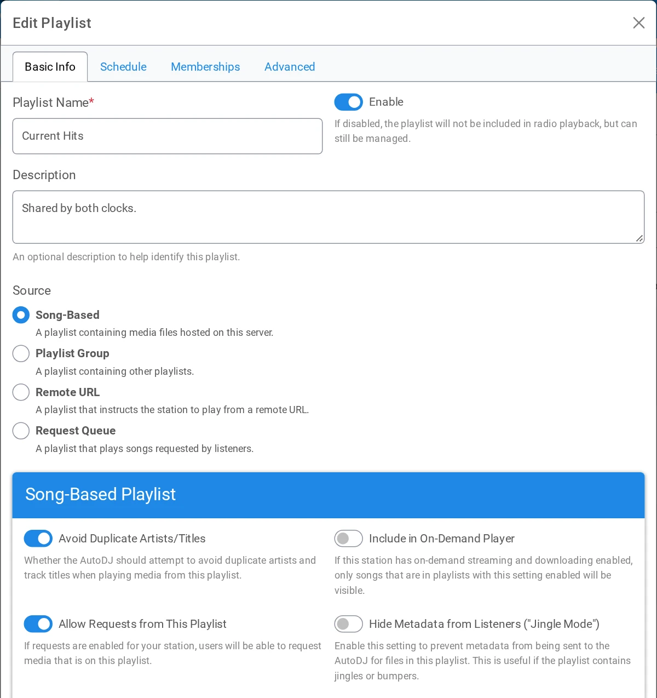

import { TabItem, Tabs } from '@astrojs/starlight/components';

Clicking **Add Playlist** on the **Playlists** page, or a playlist's **Edit** button, opens the playlist editor with these tabs:

- **Basic Info:**
  - Contains the playlist's name, source, type and playback order
  - Most settings are found here
- **Schedule:**
  - When the playlist is allowed to play
  - See [Scheduling](/docs/user-guide/playlists/scheduling/)
- **Members:**
  - Only for existing playlist groups
  - Lists the group's members
  - See [Playlist Groups](/docs/user-guide/playlists/groups/)
- **Memberships:**
  - Only for existing playlists
  - Lists the groups the playlist belongs to
- **Advanced:**
  - Extra playback options
  - Not shown for Request Queue playlists

## Basic info

- **Playlist Name:**
  - Shown in the station's lists and reports
  - Semicolons (`;`) are replaced with colons
  - For [Advanced playlists](/docs/user-guide/playlists/advanced/), the name also determines the playlist's variable name in Liquidsoap
- **Enable:**
  - A disabled playlist doesn't play at all
    - You can still edit it and its songs
- **Description:**
  - An optional note to help you and your team identify the playlist

## Source

The **Source** decides what the playlist plays. The rest of the **Basic Info** tab changes depending on the source you select.

<Tabs syncKey="playlist-source">
<TabItem label="Song-Based">

A playlist of songs from your station's media library. This is the most commonly used kind of playlist.

Song-based playlists have all the options on this page: [type](#playlist-type), [playback order](#song-playback-order) and the [options for song-based playlists](#options-for-song-based-playlists).

</TabItem>
<TabItem label="Playlist Group">

A playlist that plays other playlists. You choose its [type](#playlist-type) and its **Song Playback Order**, which here decides the order of its members.

Groups have their own **Avoid Duplicate Artists/Titles** and **Keep Queue on Restart** settings. Requests, the on-demand player and Jingle Mode aren't available for groups. Set them on the member playlists instead.

Everything else about groups is explained on the [Playlist Groups](/docs/user-guide/playlists/groups/) page.

</TabItem>
<TabItem label="Remote URL">

A playlist that plays from a URL on another server. The type is always **General Rotation**. Remote URL playlists can't be members of playlist groups.

- **Remote URL:** the address to play.
- **Remote URL Type:** what's at that address.
  - **Icecast/Shoutcast Stream URL:** a live stream. It's relayed during the playlist's scheduled times, so always give this kind of playlist a schedule. The stream starts exactly when its scheduled time begins and cuts off the song that's playing.
  - **Playlist (M3U/PLS) URL:** a playlist file. The AutoDJ downloads it and plays one of its entries per turn, in order. Once all entries have played, it downloads the file again.
  - **Other Remote URL (File, HLS, etc.):** any other remote media. Like a stream, it's played during the playlist's scheduled times.
- **Remote Playback Buffer (Seconds):** how much of a remote stream is buffered before it plays. Shorter times can cause dropouts on unstable connections. `0` uses the default of 20 seconds.

</TabItem>
<TabItem label="Request Queue">

A playlist that plays pending listener requests. When it gets its turn and no request is pending, the AutoDJ skips it and moves on.

A Request Queue playlist has no further options on this tab. You control when it plays with a schedule, or by adding it to a playlist group. See [Song Requests](/docs/user-guide/song-requests/#request-queue-playlists).

</TabItem>
</Tabs>

## Playlist type

The **Playlist Type** decides how often a song-based playlist or a group plays.

| Type | Plays | Setting |
| --- | --- | --- |
| **General Rotation** | Whenever it's picked, together with all other General Rotation playlists | **Playlist Weight** |
| **Once per x Songs** | Once after every few songs | **Number of Songs Between Plays** |
| **Once per x Minutes** | Once after every few minutes | **Number of Minutes Between Plays** |
| **Once per Hour** | Once per hour, after a set minute | **Minute of Hour to Play** |
| **Advanced** | Never on its own, it's playback is defined only by your own Liquidsoap code | none |

When playlists of different types could play at the same time, **Once per Hour** is picked first, then **Once per x Songs**, then **Once per x Minutes**, then **General Rotation**. See the [How the AutoDJ picks songs](/docs/user-guide/playlists/autodj-logic/#where-the-next-song-comes-from) page for an explanation of the details behind the AutoDJ's behaviour.

### General Rotation

General Rotation playlists share the time that isn't taken by the other types. The **Playlist Weight** (1 to 25, default 3) decides how often each one is picked compared to the others. A playlist with weight 6 is picked about twice as often as one with weight 3.

:::note
The weight is a tendency, not a guarantee. With **Avoid Duplicate Artists/Titles** turned on, a playlist is skipped when none of its songs can play without a repeat, and another General Rotation playlist plays instead. Playlists with few songs can therefore play less often than their weight suggests. See [duplicate prevention](/docs/user-guide/playlists/autodj-logic/#duplicate-prevention).
:::

### Once per x Songs

The playlist plays once, then waits until the set number of songs has played before it plays again. Only songs that listeners can see count. Jingles from other playlists don't count, but the playlist's own plays always do.

### Once per x Minutes

The playlist plays once, then waits at least the set number of minutes. After that, it plays at the next song change.

### Once per Hour

The playlist plays at the first song change after the set minute of every hour, for example :00 for the top of the hour. It can only start within 15 minutes after that minute. If no song change happens in that time, it waits for the next hour. It never plays twice within 30 minutes.

### Advanced

The AutoDJ manages the playlist's songs but never plays it by itself. You use it in your own Liquidsoap code instead. See [Advanced Playlists](/docs/user-guide/playlists/advanced/).

## Song playback order

The **Song Playback Order** decides which song a song-based playlist plays next.

| Order | Which song comes next |
| --- | --- |
| **Shuffled** | The playlist is shuffled, then played through in that order. After every song has played, it's shuffled again. |
| **Random** | A completely random song each time. Songs can repeat before others have played. |
| **Sequential** | The order you set with [**Reorder**](/docs/user-guide/playlists/managing/#playlist-actions), from top to bottom, then from the top again. |

For a [playlist group](/docs/user-guide/playlists/groups/#member-order), the same setting decides the order of its members.

## Options for song-based playlists

- **Avoid Duplicate Artists/Titles:** the AutoDJ tries not to play a song whose title or artist played recently.
  - "Recently" is the station's **Duplicate Prevention Time Range**
  - If every song in the playlist played recently, it plays the one that played longest ago
  - With **Sequential** order, this can skip ahead to the next song that didn't play recently
    - Turn it off if the order must stay exact
    - On by default

  :::caution
  Turn this off for jingles and station IDs. They usually all the same name or a generic identifier as their artist, so they count as repeats of each other. In a [playlist group](/docs/user-guide/playlists/groups/#avoiding-repeats-in-groups), the group then skips their slot. In General Rotation, they play less often than their weight suggests.
  :::

- **Include in On-Demand Player:** if the station's on-demand player is turned on, only songs from playlists with this setting are shown there.
- **Allow Requests from This Playlist:** listeners can [request](/docs/user-guide/song-requests/) songs from this playlist.
  - On by default
- **Hide Metadata from Listeners ("Jingle Mode"):** for jingles, station IDs and similar clips.
  - While such a clip plays, listeners keep seeing the title of the song before it, and no webhooks for it are triggered
  - The clip is also left out of the public song history
- **Keep Queue on Restart:** keeps the playlist's position in its current cycle when the station restarts or its configuration is updated.
  - Without it, the playlist starts a new cycle
  - **Sequential** playlists keep their position anyway, unless the station setting **Reset Sequential Playlist Queues on Restart** is on
  - Not available for **Random** order

## Advanced options

The **Advanced** tab changes how the playlist is handled at its scheduled times. Most of these options only make sense for a playlist with a [schedule](/docs/user-guide/playlists/scheduling/).

<Tabs syncKey="playlist-source">
<TabItem label="Song-Based">

- **Interrupt other songs to play at scheduled time:**
  - The playlist starts exactly when its scheduled time begins and cuts off the song that's playing. See [exact start times](/docs/user-guide/playlists/scheduling/#exact-start-times).
- **Only play one track at scheduled time:**
  - The playlist plays a single song per scheduled time, then stops until its next scheduled time.
- **Merge playlist to play as a single track:**
  - The whole playlist plays at once, every song back to back, each time it gets a turn.

</TabItem>
<TabItem label="Playlist Group">

- **Play the group's entire rotation as a single block:**
  - The group plays a full cycle of its members back to back, each time it gets a turn. See [playing a cycle as one block](/docs/user-guide/playlists/groups/#playing-a-cycle-as-one-block).

</TabItem>
</Tabs>

## Which settings apply to which source

| Setting | Song-Based | Playlist Group | Remote URL | Request Queue |
| --- | :---: | :---: | :---: | :---: |
| Playlist type | ✓ | ✓, except Advanced | | |
| Playlist weight | ✓ | ✓ | | |
| Song playback order | ✓ | ✓ (member order) | | |
| Avoid Duplicate Artists/Titles | ✓ | ✓ (for all members) | | |
| Keep Queue on Restart | ✓ | ✓ | | |
| On-demand, requests, Jingle Mode | ✓ | | | |
| Schedule | ✓ | ✓ | ✓ | ✓ |
| Advanced options | ✓ | Single block only | | |
| Can be a group member | ✓ | ✓ | | ✓ |
