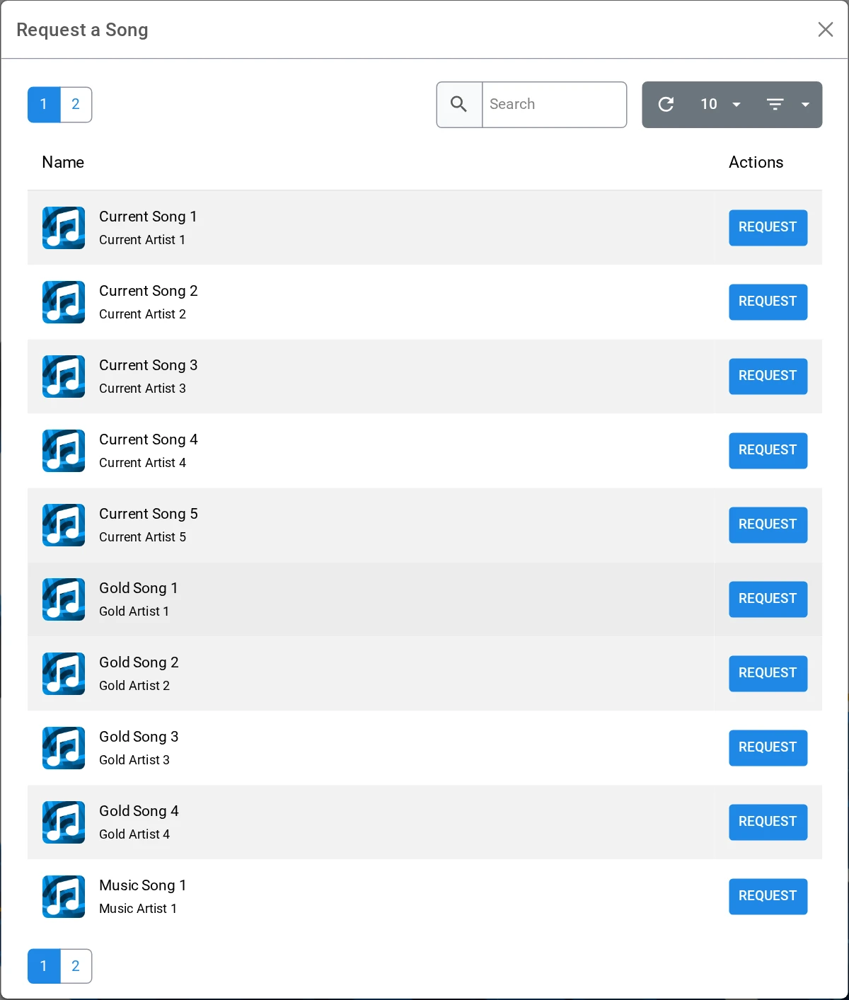

import { LinkCard, Steps } from '@astrojs/starlight/components';

With song requests turned on, listeners can pick a track from your library and the AutoDJ plays it for them. By default, a request plays as soon as it's ready, ahead of your normal rotation. With Request Queue playlists and playlist groups, you can decide exactly when and where requests play instead.

:::tip[Required Permissions]
- Changing the request settings requires the "Manage Station Profile" permission for the given station
- Creating Request Queue playlists requires the "Manage Station Media" permission
- Viewing and managing pending requests requires the "Manage Station Broadcasting" permission
:::

## Turning on requests

<Steps>

1. In the station menu, click **Edit Station Settings** and open the **Song Requests** tab

2. Turn on **Allow Song Requests**. The other request settings appear

3. Adjust the settings described below, then save

</Steps>

| Setting | What it does |
| --- | --- |
| **Allow Song Requests** | Turns requests on or off for the station. |
| **Request Minimum Delay (Minutes)** | How long a request waits before it can play. Each request waits between this value and twice this value, so that requests are spread out. The setting also limits how often one listener can send a request: once per this many minutes, and at most every 15 seconds if it's set to `0`. Logged-in users aren't limited. |
| **Request Last Played Threshold (Minutes)** | A song can't be requested if it, or a song by the same artist, played within this time. Set it to `0` to turn this check off. |
| **Only play requests via Request Queue playlists** | Turns off the general request queue, so requests only play through [Request Queue playlists](#request-queue-playlists). |

:::caution
Some stream licensing providers have specific rules for song requests. Check your local regulations before you turn requests on.
:::

## What listeners can request

Listeners can request any track that's on at least one **enabled**, **song-based** playlist that has **Allow Requests from This Playlist** turned on. This setting is on by default for new song-based playlists. Playlist groups and Request Queue playlists don't have it, so set it on the song-based playlists inside them.

:::tip[Requestable tracks that don't play in your rotation]
To make tracks requestable without the AutoDJ playing them on its own, add them to a playlist of type **Advanced** with **Allow Requests from This Playlist** turned on. The AutoDJ never picks tracks from Advanced playlists by itself.
:::

## How listeners send requests

- **Public player:**
	- The station's public player shows a **Request Song** button. It opens a searchable list of every track that can be requested.
- **Your website:**
	- On the station's **Overview** page, click **Embed Widgets** in the **Public Pages** panel and choose **Requests** to get the embed code for a request page.
- **Apps and integrations:**
	- Requests can also be sent through the [AzuraCast API](/docs/developers/apis/).

### When a request is refused

If a request can't be accepted, the listener sees one of these messages:

| Message | Why |
| --- | --- |
| This track is not requestable. | The track isn't on an enabled playlist with **Allow Requests from This Playlist**. |
| This song was already requested and will play soon. | Someone already requested this track and the request hasn't played yet. |
| This song or artist has been played too recently. Wait a while before requesting it again. | The song, or a song by the same artist, played within the **Request Last Played Threshold**. |
| You have submitted a request too recently! Please wait X minutes before submitting another one. | The same listener sent a request within the **Request Minimum Delay**. |
| You are not permitted to submit requests. | The listener is blocked by the station's **Banned IP Addresses**, **Banned Countries** or **Banned User Agents**, or isn't listed in **Allowed IP Addresses**. These settings are on the **Broadcasting** tab of **Edit Station Settings**. |
| Search engine crawlers are not permitted to use this feature. | The request came from a search engine or another bot. |

## How requests are played

Requests are played either through the general request queue or through Request Queue playlists.

### The general request queue

This is the default way that requests are played. Every time the AutoDJ picks the next song, it first looks for a pending request that has waited long enough. If it finds one, the request plays next, ahead of all playlists. Requests play in the order they were sent.

The AutoDJ only uses the general request queue for songs it picks in advance. It never interrupts a song that's playing to play a request.

### Request Queue playlists

A Request Queue playlist is a playlist whose **Source** is **Request Queue**. Instead of its own songs, it plays the oldest pending request. If no request is pending when it gets its turn, it's skipped and the AutoDJ moves on to the next playlist.

Because it's a playlist, you decide when it gets its turn:

- **On its own:**
	- Like a General Rotation playlist, within its **Schedule** if it has one
	- For example, schedule it for 18:00 to 22:00 to play requests only in the evening
- **In a playlist group:**
	- At a fixed slot in a clock
	- With **Consecutive Plays** it plays up to that many requests in a row
	- With **Play all available requests before advancing**, it plays every pending request before the group moves on

While a Request Queue playlist can play, it handles all requests and the general request queue waits. That's the case:

- on its own, while it's within its schedule (or always, without a schedule)
- in a group, while the group, and every group above it, is enabled and within its own schedule

If the group only plays **Once per x Songs**, **Once per x Minutes** or **Once per Hour**, requests wait for the group's next turn, so the group sets the pace.

A Request Queue playlist also respects your duplicate prevention. A request for a song, or an artist, that played too recently stays pending and plays later. If no pending request can play yet, the Request Queue playlist is skipped, the same as when no request is pending. In a playlist group, the group then moves on to its next member.

<LinkCard
	title="Example: A request slot in the clock"
	description="Two songs, then every pending request, then a station ID."
	href="/docs/user-guide/playlists/group-examples/#a-request-slot-in-the-clock"
/>

### Only playing requests through Request Queue playlists

With **Only play requests via Request Queue playlists** turned on, the general request queue is off completely. Requests only play when a Request Queue playlist gets its turn. While no Request Queue playlist can play, requests wait.

## Limiting when requests play

| Tool | Where | Effect |
| --- | --- | --- |
| **Block Request Queue While Active** | Schedule item of any playlist except Request Queue playlists | Pauses the general request queue while that scheduled time is active. Listeners can still send requests, which play afterwards. Request Queue playlists aren't affected. |
| **Allowed Requests** | Member settings in the **Playlist Grouping** tab | Controls whether requests from the general queue can take a member's slot while its group is scheduled and playing. See below. |
| **Only play requests via Request Queue playlists** | Station settings | Turns off the general request queue. |

### Allowed Requests in scheduled groups

While a playlist group with a schedule is within its scheduled time, a request from the general queue has to fit the member the group would play next. The member's **Allowed Requests** setting decides:

- **Any (Default):**
	- The request plays and takes that member's place, as if the member had played
	- If many requests are pending, one plays per cycle of the group
	- In groups of type **Once per x Songs**, **Once per x Minutes** or **Once per Hour**, the member's slot still plays right after the request
- **Playlist Media Only:**
	- Only a request for a track from that member can take its place, other requests wait
- **None:**
	- No request can take the member's place
	- Requests wait until a member that allows them is next

On a Request Queue playlist, or on a group that contains one, **None** also stops that Request Queue playlist from playing requests while the group holding the setting can play.

Groups without a schedule don't restrict the general request queue this way. To give requests a fixed place in an unscheduled clock, add a Request Queue playlist to it, as in the [request slot example](/docs/user-guide/playlists/group-examples/#a-request-slot-in-the-clock).

## Managing requests

Open **Reports › Song Requests** in the station menu:

- **Pending Requests** lists the requests that haven't played yet
	- You can delete single requests, or remove all of them with **Clear Pending Requests**
- **Request History** lists the requests that have played

Both lists show when a track was requested and played, and the requester's IP address.

## Troubleshooting

Requests never play

- Check that **Allow Song Requests** is on
- With **Only play requests via Request Queue playlists** on, requests only play when a Request Queue playlist gets its turn
	- Make sure one is enabled, and that its schedule, or its group's schedule, is active
- A Request Queue playlist inside a group plays only through that group
	- Check that the group is enabled
	- In a scheduled group, also check that the member's **Allowed Requests** isn't **None**
- A schedule item with **Block Request Queue While Active** pauses the general request queue while it's active
- A pending request for a song, or an artist, that played too recently waits until the **Request Last Played Threshold** has passed

Requests play right away instead of at their slot

The general request queue plays requests as soon as they're ready. It only waits while a Request Queue playlist can play. If that playlist's group is disabled or outside its schedule, the general queue takes over again. Turn on **Only play requests via Request Queue playlists** if requests should never play outside a Request Queue playlist.

A request takes much longer than the minimum delay

- Each request waits a random time between the **Request Minimum Delay** and twice that value
- A Request Queue playlist only plays requests at its turn
	- In a group of type **Once per x Songs**, **Once per x Minutes** or **Once per Hour**, that's only every so often
- In a scheduled group, **Allowed Requests** can hold requests back until a member that allows them is next
- A request for a song or artist that played too recently waits until that's no longer the case

